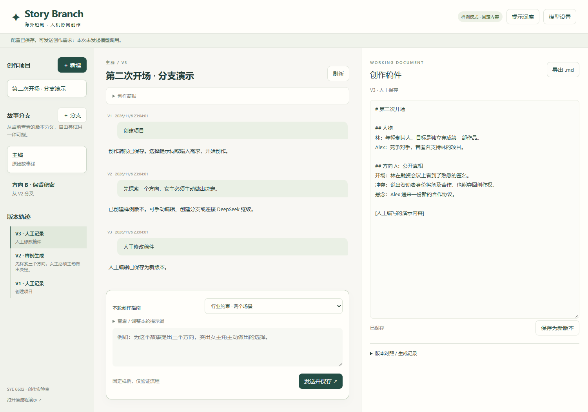

# Story Branch · 短剧创作工作台 v0.2

面向海外短剧的人机协同创作原型：提示词库、连续对话、故事分支与稿件版本管理。使用 Python FastAPI、SQLite 和原生 JavaScript 构建，支持无密钥样例模式与 DeepSeek API。



本仓库是应用源码。课程提交文件、成员信息、API 密钥和本地创作数据库不包含在仓库中。

2026-11-06：新增提示词库、连续对话、分支演化、不可覆盖的版本记录、人工编辑、版本对照、Markdown 导出与 DeepSeek 连接。首页现在是新版工作台；原版流程仍在 `/classic`，原有项目数据保留。

## 新版使用方法

1. 按下方“本地启动”启动服务，打开首页。
2. 创建项目，填写市场、语言、人物、故事种子、时长和制作限制。
3. 从提示词库选择创意、人物、大纲、剧本、诊断或本地化模板，按需要编辑本轮提示词。
4. 发送需求。每次成功回复保存完整稿件、对话、模型来源、提示词快照和父版本。
5. 在右侧直接修改稿件，点击“保存为新版本”。历史版本始终保留。
6. 点击任意历史版本，再点击“＋ 分支”。新分支只继承分叉点之前的对话和稿件，分支后的修改彼此独立。
7. 通过版本对照查看另一份稿件，通过“导出 .md”交付当前已保存版本。

提示词修改后可以另存为个人模板，跨项目使用。内置样例不是已验证的行业标准，后续应根据访谈和测试迭代。版本对照当前为全文并排阅读，未实现逐字差异标注、自动分支合并或多人实时协作。

## DeepSeek：配置后即可使用

打开“模型设置”，选择 DeepSeek，填入 API Key，保存后发送创作需求。默认模型名称为 `deepseek-flash`，可按账户可用模型修改。配置入口已完成；没有真实密钥时，仅通过模拟响应验证了请求和错误处理，尚未验证真实账户连通性及创作质量。

- 页面输入的密钥只保存在当前服务进程内存中，不写入 SQLite、浏览器存储或版本记录，不通过读取设置接口返回。
- 重启服务后需要重新填写；也可以在启动前设置 `DEEPSEEK_API_KEY` 与可选 `DEEPSEEK_MODEL` 环境变量。环境变量由用户的启动环境管理。
- 保存配置不调用模型。发送创作需求会把简报、当前稿件、最近最多 8 个祖先版本的对话摘要字段和本轮提示词发给 DeepSeek。更早对话仍在本地完整保存，但不会全部发送；关键设定应写入稿件。
- 当前上下文超过字符上限会明确拒绝请求，不静默截断稿件；网络、余额、限流、返回结构不完整等错误不会创建新版本。
- 请求成功才保存版本，多个请求竞争同一分支时用父版本校验拒绝过期写入。
- 默认样例模式不会调用外部模型，输出是固定样例，用于演示交互，不用于评价创作能力。

接口依据：[DeepSeek 官方文档](https://api-docs.deepseek.com/)。DeepSeek 与 OpenRouter 的密钥不能混用。新版使用 DeepSeek；原版 OpenRouter 流程继续保留用于课程对照。

## 新版接口

| 接口 | 用途 |
|---|---|
| `GET/POST /api/workspace/settings` | 读取不含密钥的配置状态 / 设置密钥与模型 |
| `GET/POST /api/workspace/prompts` | 查看提示词库 / 保存个人模板 |
| `GET/POST /api/workspace/projects` | 列出 / 创建项目 |
| `GET /api/workspace/projects/{id}` | 读取项目、全部分支和版本 |
| `POST /api/workspace/projects/{id}/branches` | 从指定版本创建分支 |
| `POST /api/workspace/projects/{id}/versions` | 对话生成或人工编辑，保存新版本 |

新版与原版使用同一 SQLite 文件、不同数据表。原版项目可以在 `/classic` 继续访问，尚未自动迁移到新版分支结构。备份时关闭服务并复制 `data/projects.db`。

当前版本用于单机课程演示：只监听 `127.0.0.1`，限制访问主机和跨站写入。上线给组员共同使用前还需增加登录、成员权限、HTTPS 和独立密钥配置，不能直接将此单机服务公开到互联网。

架构与后续边界见 [DEVELOPMENT.md](DEVELOPMENT.md)。

---

# 原版流程与通用启动说明

这是 SYE 6602 项目的第一段可运行流程：创作简报 → 三个故事方向 → 人工选择 → 三集大纲。项目状态保存在 SQLite，刷新页面后可用项目编号继续。首集初稿和剧本诊断尚未实现。

## 已实现

- 中文操作页面，面向英语市场的原创短剧简报。
- 三个故事方向的生成、选择和带修改要求的重新生成。
- 根据选定方向生成三集大纲，并从 SQLite 读取前一步结果。
- `create`、`revise`、`outline` 和未知动作的分支处理；输入校验、运行日志和模型调用错误处理。
- 默认**样例生成模式**，不需要密钥、不调用外部服务；页面会明确标示该模式。
- 可切换到 OpenRouter 实际生成。密钥只从服务器环境变量读取，不会发送给浏览器。

## 本地启动

在 Windows PowerShell 中，进入本文件夹后执行：

```powershell
py -3 -m venv .venv
.\.venv\Scripts\python.exe -m pip install -r requirements.txt
.\.venv\Scripts\python.exe -m uvicorn studio.main:app --host 127.0.0.1 --port 8000
```

打开 `http://127.0.0.1:8000`。默认模式可以完整演示前两步；数据保存在 `data/projects.db`。服务只应在本机演示，当前原型尚无登录权限控制。

若已获得 OpenRouter API 密钥，需要在启动服务前设置环境变量：

```powershell
$env:STUDIO_MODEL_MODE = "openrouter"
$env:OPENROUTER_API_KEY = "<your-api-key>"
$env:OPENROUTER_MODEL = "<model-id>"
.\.venv\Scripts\python.exe -m uvicorn studio.main:app --host 127.0.0.1 --port 8000
```

模型 ID 由实际账户可用模型决定。API 调用可能产生费用；建议先用样例模式完成流程测试。OpenRouter 接口按[官方 Chat Completion 文档](https://openrouter.ai/docs/api/api-reference/chat/send-chat-completion-request)实现。

## 接口与当前课程要求

| 对应部分 | 初步实现 |
|---|---|
| Custom webhook | `POST /api/action` 接收外部 JSON 并返回 JSON |
| Router | 根据 `action` 分流；未知动作返回 404 |
| Data Store | SQLite 保存简报、方向、大纲及运行日志 |
| Error handler | 模型调用失败时记录错误，并返回 502 |
| OpenRouter | 可配置真实 OpenRouter Chat Completion 调用 |
| Three scenarios | 目前完成创意生成与大纲两个相互衔接的工作流；首集初稿是下一阶段 |

接口说明见 `http://127.0.0.1:8000/docs`。当前阶段尚未完成课程最终要求的三个工作流，不应将本原型展示为完整项目。

## 运行测试

```powershell
.\.venv\Scripts\python.exe -m unittest discover -s tests -v
```

测试覆盖正常输入、无效输入、未知动作、模拟模型失败和后续读取已保存数据。测试不需要 API 密钥。

## 下一阶段

增加第 1 集样稿和“剧本医生”工作流，并记录每一步输入输出作为课程展示证据。行业访谈与内容评价仍是计划工作，不能作为已经完成的结果展示。
